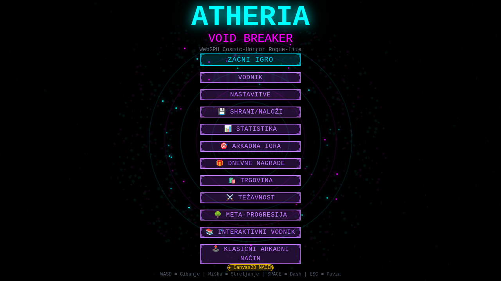
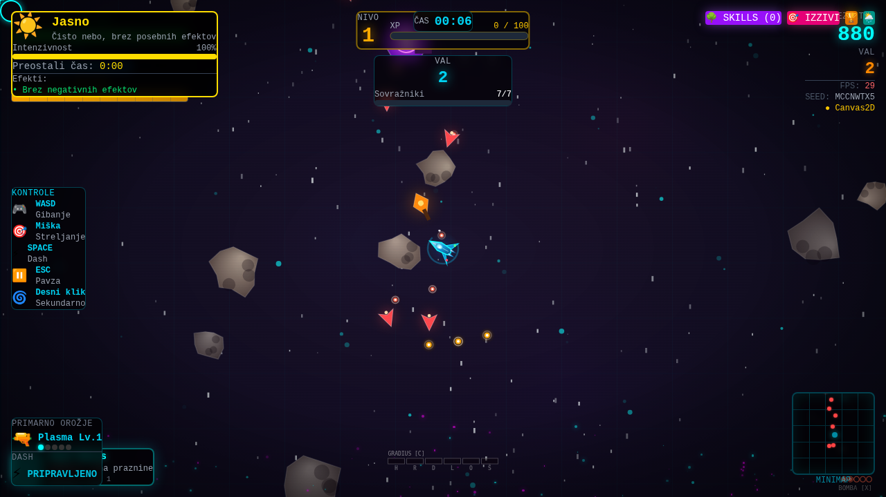

# 🚀 ATHERIA: VOID BREAKER

> **WebGPU vertikalni vesoljski strelec z rogue-lite napredovanjem** — leti naprej skozi poimenovane sektorje, se izogibaj asteroidom, preživi WARNING in potopi bossa v praznino.

[](https://github.com/robertpezdirc8-prog/igra/actions/workflows/deploy.yml)


**🎮 Igraj v brskalniku:** https://robertpezdirc8-prog.github.io/igra/

|  |
|:---:|
| *Glavni meni* |

|  |
|:---:|
| *Napredujoči polet: plastna ladja, pravi asteroidi, GRADIUS merilec, minimapa* |

---

## 📖 O igri

ATHERIA: VOID BREAKER je **vertikalni scroller shoot 'em up** v duhu arcade klasik
(Gradius, Raiden, Truxton, DoDonPachi), zgrajen z modernim tehnološkim kupom.
Ladja vedno leti naprej — svet se premika pod njo, asteroidni pasovi plavajo proti njej,
sovražniki izvajajo strafe-run lete od zgoraj, vsak tretji val vsakega sektorja blokira
**MID BOSS predstraža**, vsak peti val pa prinese **WARNING klakson** in bossa z lastno
vektorsko podobo in imenovano HP litico.

- **Igralna zanka:** leti → izogibaj se kamnom → jasi valove → **predstraža** → pobiraj medalje in črke → WARNING → boss → SEKTOR JASEN tally → ponovi, težje
- **Permadeath s progresijo:** smrt konča tek, zlato, veščine, dosežki in dvorana slavnih ostanejo
- **Prilagodljiva plastna glasba:** soundtrack je sintetiziran v realnem času (WebAudio) in *raste z akcijo* — bobni se prižgejo v boju, boss dobi lasten disonantni sloj
- **GPU pospešeno:** delci prek WebGPU (do 10 000 instanc, 1 draw call) + **bloom post-processing**, samodejni fallback na Canvas2D

---

## 🎮 Kontrole

| Dejanje | Namizje | Gamepad | Mobilno |
|---|---|---|---|
| Premikanje | `W A S D` / puščice | leva palica / D-pad | virtualna palica |
| Namerjanje + streljanje | miška (drži) | samodejno + gumbi | rdeči gumb |
| Dash (i-frames) | `SPACE` | A / X | cyan gumb |
| Bomba (počisti izstrelke) | `B` | B / krožni gumb | BOMBA gumb |
| Gradius izbor | `V` | Y / trikotnik | GRAD gumb |
| Sekundarno orožje | desni klik | RB / R1 | vijolični gumb |
| Temporal Stasis | `Q` | LB / L1 | — |
| Pavza | `ESC` | START/OPCIJE | gumb ☰ |

> 💡 Gamepad se zazna samodejno (hot-plug) — poveži in igraj. `preventDefault` velja
> izključno za igralne tipke med igranjem, zato F5/Tab/Ctrl+R delujejo normalno.

---

## 🗺️ Sektorska struktura (Gradius šola)

Igra je razdeljena na **poimenovane sektorje** po 5 valovih, vsak z lastno barvno identiteto:

| Sektor | Ime | Atmosfera |
|---|---|---|
| 1 | **OUTPOST GATE** | mejna patrulja, turizna |
| 2 | **ASTEROID FIELDS** | gosen pas kamnov, oranžna |
| 3 | **NEBULA VEIL** | ionska nevihta, vijolična |
| 4 | **SCRAP FLEET** | armada razbitin, rdeča |
| 5 | **VOID CITADEL** | sovražna trdnjava, magenta |

- Vsak sektor se začne s **stage-card** uvodnim napisom in konča z bossom
- **3. val vsakega sektorja: MID BOSS predstraža** — nosilka razreda *carrier*
  (PREDSTRAŽA-ALFA/BETA/GAMA) se spusti z vrha, lebdi po sinusni krivulji in
  strelja namerjane vršaje; pod 40 % HP zagori v berserk (hitrejši vršaji +
  vmesni prstani). Ubij jo hitro za bounty (+300×sektor, medalja + kapsula) —
  ali jo izteguj: po 15 s se umakne brez nagrad, val se ne more zablokirati
- Ozadje dobi sektorsko barvno pranji (klasični arcade premik palete)

## 👹 Bossi in predstraže (rotirajoča zaseda)

**MID BOSS predstraže** (3. val vsakega sektorja): oklepna nosilka z vrtčečima
topovskima gnezdoma in žarečim jedrom, ki gpredi zadiha pod udarci — imenovana
jantarna HP litica, koreografirana smrt v ognjenem obroču.

**Glavni bossi** (vsak 5. val): **3,5 s WARNING faza** — utripajoč rdeč napis,
animirani nevarnostni trakovi, zračna klakson sirena. Šele nato vstopi boss:

- 🌌 **Cosmic Horror** — magenta grozota, spiralni in krožni vzorci
- 💀 **Mehanska lobanja** (Truxton poklon) — oranžna, laserski in homing vzorci
- 🛰️ **Void postaja** — turizna trdnjava, valovni in burst vzorci

Bossi imajo imenovane HP litice, več faz, adaptivno AI, ki analizira tvoje begove —
in **koreografirano smrt**: 1,6 s verižnih eksplozij po trupu (slow-motion + glasbeno
dušenje), nato končni megablast z nagradami.

## ⚖️ Poštena težavnost

- **Proračun po sektorjih** s trdimi kapicami: HP +12 %/sektor (do 2,2×),
  hitrost izstrelkov +6 %/sektor (**do 1,35×** — vzorci ostanejo berljivi),
  hitrost streljanja +5 %/sektor (do 1,3×)
- **Nevidna adaptivna pomoč:** 4+ zadetki v 15 s gladko ublažijo izstrelke (do 0,88×),
  neutakana igra se vrne na 1,0× — igralec le čuti »to je pošteno«
- 5 izbirnih stopenj: `Easy → Normal → Hard → Nightmare → Impossible`

## 🏆 Nagradne zanke (Raiden / DoDonPachi šola)

- **Medalje z verigo:** hitro pobiranje gradi verigo (do ×8 vrednosti)
- **Medaljna serija:** zaporedne medalje brez zadetka do **2× vrednosti**; udarec ponastavi
- **Popoln val:** brez zadetka skozi cel val → bonus `BREZ ZADETKOV`
- **SEKTOR JASEN tally panel** po bossu — vrstica za vrstico: osnova,
  BREZ ZADETKOV (5000×sektor), MEDALJE ×n, SKUPAJ
- **Val jasen bonus** vsak val + **črke**: `P` moč, `S` hitrost, `B` bomba, `O` opcija
- **Offline dvorana slavnih:** top 10 tekov z statistiko

## 🔫 Klasični arcade sistemi

| Sistem | Vir | Kaj dela |
|---|---|---|
| GRADIUS merilec + ŠČIT + OPCIJE | Gradius | kapsule polnijo merilec; ščit absorbira udarce; do 3 dronov |
| Bomba + protibomba | Raiden | počisti izstrelke; protibomba reši pri zadetku |
| Wave cannon | R-Type | drži za naboj, spusti za žarek |
| Plazma laser | Raiden II | začasna vijolična »toothpaste« |
| Danmaku sine izstrelki | DoDonPachi | sniper trojčki se prepletajo stransko |
| Medalje + verige | Raiden/DoDonPachi | glej zgoraj |

---

## 🎵 Prilagodljivi soundtrack

```
intenzivnost 0        1                 2                 BOSS
           │          │                 │                  │
  bas ▂▂▂────────────────────────────────────────────────────  (vedno)
  pad ▂▂▂────────────────────────────────────────────────────  (vedno)
  bobni            ▂▂▂─────────────────────────────────────  (boj)
  arp lead                           ▂▂▂───────────────────  (vroče)
  boss sloj                                           ▂▂▂▂▂  (double-kick +
                                                              snare + disonanca)
```

- 16-stopenjski lookahead sequencer (AudioContext ura = natančnost), **132 BPM, A frigijska**
- Akordna zanka Am → F → G → Em; boss sloj = minor-sekundno trepetanje (klasična »boss tema«)
- `duck()` ob boss smrti: lowpass sweep — svet upočasni, glasba zaduši
- Vsi SFX sintetizirani (0 zvočnih datotek): klakson, laserski FM, eksplozije z sub-bass

---

## 🖥️ Renderiranje

```
┌─────────────────────────────────────────────┐
│  canvas #1 (2D)                             │  ozadje, sovražniki, projektili,
│  → CanvasRenderingContext2D                 │  ladja, bossi, tally, WARNING
├─────────────────────────────────────────────┤
│  canvas #2 (WebGPU overlay, prosojen)       │  delci: instancirani kvadratki
│  → GPUCanvasContext + pipeline + BLOOM      │  1 draw call do 10 000 delcev
├─────────────────────────────────────────────┤
│  React UI (DOM)                             │  HUD, meniji, skill tree, trgovina
└─────────────────────────────────────────────┘
```

- **Bloom v3:** prag 0,45, ločljivi Gaussian v polovični resoluciji — sijaj brez mehčanja
- **Realistični izstrelki:** rakete s trdim pogonom (pospešujejo do izgorevanja), kovinskim
  truplom, bojevo glavo, repnimi krilci, **udarnimi diamanti** v curku, dimno sledjo in
  **RCS pufi** ob ostrih homing zavojih; izstrelitveni blisk z iskrami; nasprotnikovi
  plazma-orbi s pulzirajočim halojem in gobo gibanja; tracer-steaki za vulkanski strel
- **Naravnost-gor baterija:** vsi igralčevi streli potujejo vzporedno navzgor (vzporedni
  stolpci namesto kotne pahljače) — klasična vertikalna namerilna logika
- CPU pakuje delce v 48 B/delec → staging buffer → instancirani izris
- **Parallax zvezdnato nebo:** 260 zvezd v 3 globinskih slojih, realistična zvezdna paleta
  (belo / toplo / hladno), utripanje po lastni fazi, hitrostni streaki, ki se podaljšujejo
  s pospeškom leta, štirizvezdni blisk najsvetlejših bližnjih zvezd
- Brez WebGPU → samodejni Canvas2D fallback (isti vizualni rezultat)

## ⛰️ Svet, ki leti naprej

- **Vertikalni svetovni scroll** (70 → 160 px/s z valovi) — nič več stojanja na mestu
- **Pravi asteroidi:** nepravilne silhuete (9–12 točk), radialno sencenje + **spekularni
  svetlobni odsvev** proti ključni svetlobi, kraterji z osvetljenim robom,
  5 sivkino-rjavih palet; vsak kamen ima lastno hitrost (0,55–1,45× × stopnja) in
  odrega prah ob kotalenju
- **Progresivno razpadanje kamnov:** zadeti asteroidi dobijo razpoke (3 stopnje
  poškodbe + iskre ob udarcu); veliki razstreljeni kamni se razdvojijo v dva
  drobca, ki ju lahko nadaljnje uničuješ — drobci zgorejo na izhodu iz polja
- **Poškodovana ladja (klasični shmup megafon):** pod 35 % trupa ladja kadi,
  pod 15 % tudi pljune ogenj; rdeča pulzirajoča vinjeta opozarja na kritično stanje
- **Zalet se = škoda** (dash i-frames in Gradius ščit so štejeta) — izogibanje je veščina
- **Sovražniki izvajajo lete:** formacije pridejo od zgoraj, posamezniki se potopijo
  v strafe-run in se vrnejo s zgornjega roba (pošteno omejeno število hkratnih potopov)
- **Per-tip oblikovanje ladij:** dart/marksman/gunship imajo vsak svojo vektorsko podobo

---

## 🏗️ Arhitektura

### Ključno načelo: **engine je enoten vir resnice**

React UI **ne vodi vzporednega stanja igre**. Vse spremembe gredo skozi javni API
engine-ja, UI pa bere realne podatke prek getterjev (fingerprint sync ~10 Hz,
re-render samo ob dejanski spremembi).

```
React (App.tsx)          GameEngine (engine.ts)          Sistemi
──────────────           ─────────────────────           ───────
startGame ──────────▶    zanka, fizika, kolizije   ◀───  MusicEngine (glasba)
chooseUpgrade ──────▶    valovi, sektorji, bossi   ◀───  BossAI (vzorci)
pause/resume ───────▶    WARNING, tally, medalje   ◀───  AdvancedEnemyAI
gamepad poll ───────▶    XP, zlato, statistika     ◀───  WebGPURenderer (+bloom)
UI ◀── getGameStats() / getMinimapData() / getPlayer()    SaveSystem / Meta
```

### Struktura projekta

```
├── index.html                  # lang=sl, OG meta, SVG favicon
├── vite.config.js              # base "/igra/" za GitHub Pages
├── eslint.config.js            # flat config (js + ts + react-hooks)
├── .github/workflows/
│   └── deploy.yml              # typecheck → build → Pages deploy
├── docs/screenshots/           # prave slike zaslona (menu, gameplay)
└── src/
    ├── App.tsx                 # UI orkestracija; sync ~10 Hz s fingerprint-detekcijo
    ├── game/
    │   ├── engine.ts           # GameEngine: zanka, sektorji, bossi, WARNING, tally,
    │   │                       #   orožja, medalje, gamepad, kolizije, delci, HUD
    │   ├── musicEngine.ts      # prilagodljivi plastni soundtrack (lookahead sequencer)
    │   ├── webgpu-renderer.ts  # WebGPU instancirani delci + bloom v3
    │   ├── audio.ts / audioSystem.ts  # sintetizirani SFX (klakson, FM laser, …)
    │   ├── enemyAI.ts          # AdvancedEnemyAI + BossAI (vzorci po fazah)
    │   ├── difficulty.ts       # 5 stopenj (množniki) + unlocki
    │   ├── skillTree.ts        # 3 veje × 5 veščin → computeSkillBonuses()
    │   ├── saveSystem.ts       # save v2.0.0 + migracija v1→v2
    │   ├── statsSystem.ts      # življenjska statistika + dvorana slavnih (top 10)
    │   ├── achievements.ts / dailyChallenges.ts / cosmetics.ts
    │   ├── classicShooter.ts / classicEnemySystem.ts / classicArcadeEngine.ts
    │   ├── advancedPowerups.ts / podSystem.ts / weatherSystem.ts
    │   ├── destructibleEnvironment.ts / levels.ts / environment.ts
    │   └── metaProgression.ts / verticalScroller.ts / systems.ts
    ├── components/             # 60+ React komponent (meniji, HUD, paneli)
    └── utils/pseudoRandom.ts   # determinističen PRNG (čisti render efekti)
```

### Type-safe in čisti render

- TypeScript **strict** (`tsc --noEmit` v CI) + ESLint flat config (react-hooks + react-compiler pravila)
- `Math.random()` / `Date.now()` ne sobivajo v renderju → `pseudoRandom(seed)`

---

## 💾 Shranjevanje (save v2.0.0)

En JSON v `localStorage` (`atheria_save_data`), verzioniran z **migracijo v1 → v2**:

| Sekcija | Vsebina |
|---|---|
| `player` | high score, čas, tekmi, ubijenci, boss kills, najvišji val/nivo, max combo |
| `skillTree` | nivoji vseh 15 veščin (`offense/defense/utility`) |
| `skillPoints` | neporabljene skill točke |
| `difficulty` | izbrana težavnost |
| `achievements` | odklenjeni dosežki (15) |
| `completedChallenges` | dnevni izzivi po datumu (seed-generirani, 7-dnevne nagrade) |
| `settings` | glasnost glasbe/SFX, FPS, kakovost delcev |
| `cosmetics` | 18 predmetov (sledi, avre, okvirji) + opremljeni |
| `currency` | zlato, dragulji, XP za naslednji tek |

Ločeno: `atheria_leaderboard` (dvorana slavnih top 10), dnevne nagrade, visoka rezultata.

---

## 🚀 Zagon

**Zahteve:** Node 18+ (priporočeno 20), npm

```bash
# 1. Kloniraj in namesti
git clone https://github.com/robertpezdirc8-prog/igra.git
cd igra
npm install

# 2. Razvojni strežnik (http://localhost:5173/igra/)
npm run dev

# 3. Kakovost kode
npm run typecheck     # TypeScript strict
npm run lint          # ESLint

# 4. Produkcija
npm run build         # izhod v dist/
npm run preview       # lokalni predogled
```

> **WebGPU** zahteva Chrome/Edge 113+, Firefox 141+ ali Safari 26+. Brez njega igra
> samodejno teče v Canvas2D načinu — funkcionalnost je identična.

## 🌍 Deployment (GitHub Pages)

Workflow `.github/workflows/deploy.yml` ob vsakem pushu na `main`:
`npm ci` → `npm run typecheck` → `npm run build` → `actions/deploy-pages@v4`.
Repo: **Settings → Pages → Source = GitHub Actions**. Stran: `/igra/` (base v `vite.config.js`).

## 🔧 Tehnične odločitve (zakaj tako?)

| Odločitev | Razlog |
|---|---|
| Engine kot enoten vir resnice | Odpravi desync zamrznitve (pavza/restart/level-up) |
| 2 platna (2D + WebGPU) | Canvas dopušča samo en context type |
| CPU fizika, GPU izris + bloom | Readback iz GPU je drag; CPU ostane vir resnice |
| UI sync 10 Hz + fingerprint | 60×/s setState je povozil React in jemlje FPS |
| Lookahead glasbeni sequencer | setInterval ne more timingati — AudioContext ura je natančna |
| Kapice na težavnostnih rampah | Danmaku mora ostati berljiv — pošteno > težko |
| Nevidna adaptivna pomoč | Moderni standard (God of War, Celeste assist) |
| Proceduralni WebAudio | 0 zvočnih datotek, instant nalaganje, nič licenc |

## 🗺️ Roadmap

- [x] Vertikalni scroller + pravi asteroidi + leti sovražnikov
- [x] Gamepad podpora (palica + D-pad + gumbi)
- [x] Rotirajoča boss zaseda z WARNING fazo in koreografirano smrtjo
- [x] Prilagodljiva plastna glasba (boss sloj, duck)
- [x] Sektorska struktura + pošten težavnostni proračun + nagradne zanke
- [x] Elitne različice sovražnikov (afiksi OKLEPEN/HITRI/NEVAREN/ZLATEN/STAREŠINA)
- [x] Weapon evolution (VOID RIFT pri 8. nivoju)
- [x] MID BOSS predstraže (carrier vanguard na 3. valu vsakega sektorja)
- [ ] Online leaderboard (Supabase) — dvorana slavnih je pripravljena na zamenjavo
- [ ] Lokalizacija EN/SI preklopnik

## 🤝 Sodelovanje

PR-ji so dobrodošli! Pred oddajo poženi:

```bash
npm run typecheck && npm run lint && npm run build
```

## 📄 Licenca

[MIT](./LICENSE) © robertpezdirc8-prog
